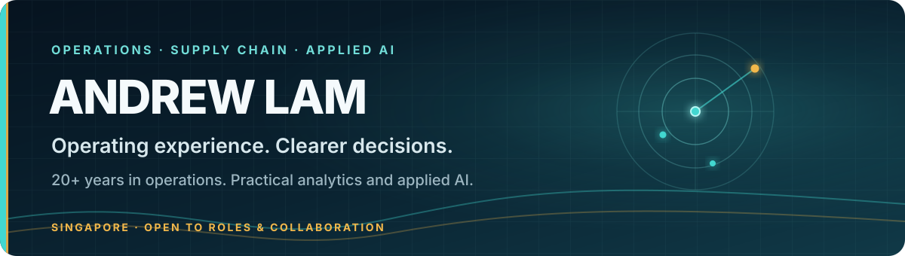

  

# Andrew Lam

**From operating records to clearer decisions.**

I'm an operations and supply-chain professional in Singapore, bringing **20+ years in logistics and operations** to practical analytics and applied AI. My experience spans cold-chain warehousing, grocery distribution, container operations and international freight forwarding.

I use **Python, SQL, Power BI and Excel** to investigate operating questions and build tools people can inspect. My next chapter connects operations intelligence, cloud engineering and the development of **VELYQUA** and **ORQEVIA**.

[**Explore my portfolio**](https://authority-engine-app.vercel.app/) · [**Inspect the evidence**](https://authority-engine-app.vercel.app/evidence?grade=real) · [**Discuss an opportunity**](https://authority-engine-app.vercel.app/contact?source=github&intent=role) · [LinkedIn](https://www.linkedin.com/in/lam-teck-sing-andrew-79886719/)

## Evidence you can inspect

**391 anonymised container jobs · 7 reporting periods · S$75,720 recorded revenue**

Follow the records into workload, service mix, amendments and workforce-planning questions in the [Container Operations Performance Dashboard](https://authority-engine-app.vercel.app/maxwell-excel). These figures describe the underlying records; business-impact outcomes require separate evidence.

For a different view, explore [Cold-Chain Risk Intelligence](https://authority-engine-app.vercel.app/evidence?grade=synth), a Power BI, SQL and Python demonstration using **1,800 synthetic records across six warehouse zones**, or the [Supply Chain Control Tower concept](https://authority-engine-app.vercel.app/evidence?grade=concept). Each carries its own evidence label.

## Selected work

Pick a project, try a public experience, or inspect its source.

| Project | What you can explore |
| --- | --- |
| **[VELYQUA · 维澜](https://velyqua-workspace.five12345.chatgpt.site/)** [Open the app](https://velyqua.vercel.app/) · [Source](https://github.com/AndrewLamSingapore/velyqua) | **Intelligence for living water.** Record manual water tests, keeper observations and care history. The Architecture Studio explains the system, cloud deployment choices and research direction. |
| **[ORQEVIA · 奥启维亚](https://authority-engine-app.vercel.app/orqevia)** [Source](https://github.com/AndrewLamSingapore/orqevia) | **Work you can inspect.** Try a curated decision walkthrough. The underlying AI orchestration workspace explores traceable work, durable memory and recoverable missions; operational execution uses authenticated access. |
| **[Authority Engine](https://authority-engine-app.vercel.app/)** [Source](https://github.com/AndrewLamSingapore/authority-engine) | **Operations intelligence and applied AI.** Explore my operating evidence, analytical casework, decision frameworks and project portfolio. |
| **[THE PORTAL](https://the-portal-ten.vercel.app/)** [Source](https://github.com/AndrewLamSingapore/the-portal) | **Follow an idea somewhere unexpected.** Explore an AI-assisted archive, knowledge graph, evidence labels, source trails and cloud deployment guide. |
| **[Living Worlds](https://game-platform-wine-nine.vercel.app/)** [Source](https://github.com/AndrewLamSingapore/game-platform) | **Your choices. A world that remembers.** Preview three illustrated RPG openings and explore a prototype built around persistent campaigns and deterministic rules. |
| **[The Sky Tablet](https://sky-tablet.vercel.app/)** [Source](https://github.com/AndrewLamSingapore/sky-tablet) | **An ancient city. An open sky.** Journey through a Three.js/WebGL storytelling experiment connecting Mesopotamia, cuneiform and astronomy, with historical interpretation clearly labelled. |

VELYQUA's current software supports aquarium records and manual observations. Physical sensor performance, AI-assisted monitoring and intervention outcomes remain development and validation goals. Its educational walkthrough keeps synthetic examples separate from aquarium records.

[Browse all repositories](https://github.com/AndrewLamSingapore?tab=repositories)

## What I bring

- **Operating context:** understand workload, capacity, exceptions, handovers and the people making the decision.
- **Practical analytics:** turn records into useful measures and traceable calculations using Python, SQL, Power BI and Excel.
- **Clear reasoning:** identify the constraint, make assumptions visible and test a useful change.
- **Applied learning:** connect completed AI and analytics training with ongoing cloud support and DevOps study.

I completed **Applied AI and Data Analytics through RISE by BCG U in October 2026**, with **BCG RISE Capstone Top 2**, **Python Expert** and **Machine Learning Expert** credentials. I am studying **Cloud Support & DevOps** through the SkillsFuture Career Transition Programme delivered by **Generation Singapore in partnership with Temasek Polytechnic**, covering Linux, Python, Microsoft Azure and automation.

Industrial AI and operations intelligence are my developing direction. IoT, data engineering and MLOps are areas I aim to build through validated projects.

<strong>View credentials and verification links</strong>

| Credential | Issuer | Verification |
| --- | --- | --- |
| Applied AI and Data Analytics · October 2026 | RISE by BCG U | [Accredify certificate](https://accredify.io/verify?id=462f1532-0ed6-4ceb-9d23-9a04f2893e4f) |
| BCG RISE Capstone Top 2 (Business and Data Analytics) | Boston Consulting Group | [Credly badge](https://www.credly.com/badges/2e0b4f50-24af-4d42-839d-b77b1b0f9231) |
| BCG RISE Python Expert | Boston Consulting Group | [Credly badge](https://www.credly.com/badges/434cbaa4-5aee-4066-b7c8-9895a6a5e24d) |
| BCG RISE Machine Learning Expert | Boston Consulting Group | [Credly badge](https://www.credly.com/badges/281a8911-39cd-4716-a987-1d0580e0f732) |
| WSQ Essential Drone Flying Technologies for Business Operations · July 2026 | NTUC LearningHub | [Certificate](https://www.ntuclearninghub.com/verify?id=cd1307a0-5409-4188-84a6-ae56c9bfbbe1) |

## Let's connect

I'm open to **Singapore-based operations intelligence, AI-enabled operations, analytics and cloud support opportunities**, alongside operations and supply-chain roles where my experience can add value.

I'm also developing VELYQUA toward a focused, measurable pilot. I welcome conversations with aquarium and aquaculture operators about a specific monitoring problem, reliable data and the evidence needed to assess a useful outcome.

Bring the operating problem, the decision you need to make and the change you want to measure.

[**Discuss a role**](https://authority-engine-app.vercel.app/contact?source=github&intent=role) · [**Explore a collaboration**](https://authority-engine-app.vercel.app/contact?source=github&intent=collaboration) · [**Connect on LinkedIn**](https://www.linkedin.com/in/lam-teck-sing-andrew-79886719/)

Maintainer references

Portfolio status reference: [STATUS.md](https://github.com/AndrewLamSingapore/orqevia/blob/main/STATUS.md). The [operational manifest](https://github.com/AndrewLamSingapore/orqevia/blob/main/governance/operational-manifest.json) is a dated component and observation reference. Each product owns its source, configuration, contracts and domain records. This profile does not establish current private runtime or deployment status.

Source references reviewed for this profile refresh on 22 November 2026: [VELYQUA 1780a07](https://github.com/AndrewLamSingapore/velyqua/commit/1780a07b36a7166dd3e70bd92d5a03f28b279a28) and [ORQEVIA ced0853](https://github.com/AndrewLamSingapore/orqevia/commit/ced0853b9bd903ea6b2b82bde8a7aca7de73abcb). Source review, live deployment, physical validation and commercial acceptance have separate evidence requirements.

