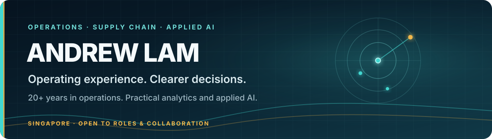

  

# Andrew Lam

**Operations Transformation & Analytics · Supply Chain · Applied AI** 
Singapore

I bring **20+ years of experience in logistics, warehousing, supply chain and container operations** to practical analytics and decision-support systems. My focus is making operational information easier to understand, risks easier to spot and decisions easier to explain.

I completed **Applied AI and Data Analytics under RISE by BCG U in October 2026**, with **BCG RISE Capstone Top 2**, **Python Expert** and **Machine Learning Expert** credentials.

I build and document independent software projects connecting operational experience with analytics, AI orchestration and interactive experiences. Start with the evidence below, then explore the code.

[**Explore my portfolio →**](https://authority-engine-app.vercel.app/) · [LinkedIn](https://www.linkedin.com/in/lam-teck-sing-andrew-79886719) · [Contact](https://authority-engine-app.vercel.app/contact?source=github&intent=collaboration)

## Find your starting point

**For operations and analytics:** inspect the [operating evidence](https://authority-engine-app.vercel.app/evidence). **For interactive experiences:** try [Living Worlds](https://game-platform-wine-nine.vercel.app/) or [The Sky Tablet](https://sky-tablet.vercel.app/).

## Selected work

Six independent projects. Open a public experience or inspect its owning source.

| Project | Focus |
| --- | --- |
| **[Authority Engine](https://authority-engine-app.vercel.app/)** [Source](https://github.com/AndrewLamSingapore/authority-engine) | Public operations portfolio: operating records, analytical casework and decision frameworks. |
| **[ORQEVIA · 奥启维亚](https://authority-engine-app.vercel.app/orqevia)** [Source](https://github.com/AndrewLamSingapore/orqevia) | AI orchestration and explainable decision support, evolved from JARVIS PRIME. Public source and a curated walkthrough; authenticated runtime access and deployment acceptance are separate. |
| **[VELYQUA · 维澜](https://velyqua.vercel.app/)** [Source](https://github.com/AndrewLamSingapore/velyqua) | Software prototype for living-water observations and explainable decisions. Real-water and sensor validation are separate work. |
| **[The Portal](https://the-portal-ten.vercel.app/)** [Source](https://github.com/AndrewLamSingapore/the-portal) | Discovery prototype connecting knowledge, artifacts and questions. |
| **[Living Worlds](https://game-platform-wine-nine.vercel.app/)** [Source](https://github.com/AndrewLamSingapore/game-platform) | Interactive game prototype exploring choices and persistent state. |
| **[The Sky Tablet](https://sky-tablet.vercel.app/)** [Source](https://github.com/AndrewLamSingapore/sky-tablet) | Educational experience connecting cuneiform tablets with an interactive ancient night sky. |

[All repositories](https://github.com/AndrewLamSingapore?tab=repositories) · [Public technical discussions](https://github.com/AndrewLamSingapore/orqevia/discussions)

## Credentials

| Credential | Issuer | Verification |
| --- | --- | --- |
| Applied AI and Data Analytics · October 2026 | RISE by BCG U | [Accredify certificate](https://accredify.io/verify?id=462f1532-0ed6-4ceb-9d23-9a04f2893e4f) |
| BCG RISE Capstone Top 2 (Business and Data Analytics) | Boston Consulting Group | [Credly badge](https://www.credly.com/badges/2e0b4f50-24af-4d42-839d-b77b1b0f9231) |
| BCG RISE Python Expert | Boston Consulting Group | [Credly badge](https://www.credly.com/badges/434cbaa4-5aee-4066-b7c8-9895a6a5e24d) |
| BCG RISE Machine Learning Expert | Boston Consulting Group | [Credly badge](https://www.credly.com/badges/281a8911-39cd-4716-a987-1d0580e0f732) |
| WSQ Essential Drone Flying Technologies for Business Operations · July 2026 | NTUC LearningHub | [Certificate](https://www.ntuclearninghub.com/verify?id=cd1307a0-5409-4188-84a6-ae56c9bfbbe1) |

## Tools I use

**Power BI · SQL · Python · Excel · Applied AI**

My focus is operational analysis, KPI reporting, root-cause analysis, workforce planning and decision support. Project repositories document their own implementation stacks and development status.

## Where I contribute

- **Operational visibility:** connect workload, capacity, exceptions and handovers into a clearer operating picture.
- **Practical analytics:** turn records into useful measures, traceable calculations and decisions grounded in evidence.
- **Decision-support systems:** build tools that keep observations, recommendations and executed actions distinct.
- **Continuous improvement:** identify the constraint, test a useful change and learn from the result.

## Evidence you can inspect

- **Real operating records:** [391 anonymised container jobs across 7 reporting periods](https://authority-engine-app.vercel.app/maxwell-excel), with **S$75,720 in recorded dataset revenue**. This is an operating-record figure, not a claim of profit, savings or measured improvement.
- **Synthetic demonstration:** [1,800 cold-chain records across 6 warehouse zones](https://authority-engine-app.vercel.app/evidence?grade=synth), used to explore how weak signals can reveal operational risk.
- **Design concept:** [a supply-chain control tower](https://authority-engine-app.vercel.app/evidence?grade=concept), connecting supplier, inventory and operating signals.

The portfolio labels real records, synthetic demonstrations and concepts separately. Public prototypes demonstrate the work; their scope is described alongside each project.

## How I work

**Observe → Connect → Anticipate → Decide → Act → Learn**

Start with the operating problem and the available evidence. Find the bottleneck, make assumptions explicit and test the smallest useful change. Keep the reasoning understandable to the people making the decision.

[Explore the decision frameworks →](https://authority-engine-app.vercel.app/frameworks)

## Let's connect

I'm open to **operations excellence, operational analytics and supply-chain roles**, and practical collaborations in decision support and applied AI.

Share the operating problem, the decision that needs to be made and the outcome you want to improve.

[**Discuss a collaboration →**](https://authority-engine-app.vercel.app/contact?source=github&intent=collaboration) · [**Hiring? Start here →**](https://authority-engine-app.vercel.app/contact?source=github&intent=role) · [**Connect on LinkedIn →**](https://www.linkedin.com/in/lam-teck-sing-andrew-79886719)

Maintainer references

Portfolio status reference: [STATUS.md](https://github.com/AndrewLamSingapore/orqevia/blob/main/STATUS.md) in the public ORQEVIA repository. The [operational manifest](https://github.com/AndrewLamSingapore/orqevia/blob/main/governance/operational-manifest.json) is a dated component and observation reference only. Each product owns its source, configuration, contracts and domain records. This profile does not establish current private runtime or deployment status.

